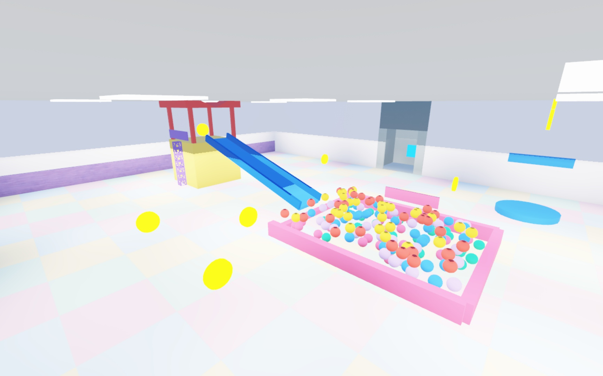

# 냥찜 스파랜드 (Nyangjjim Spaland)

**초등학교 3학년 조카가 말로 기획하고, AI가 코드로 만든 로블록스 찜질방 게임.**

조카는 코드를 한 줄도 쓰지 않았습니다. 하고 싶은 게임을 **입으로 말했고**, 삼촌이 그 말을 그대로 받아 치거나 음성 입력으로 AI 코딩 에이전트(Claude Code)에게 전달했습니다. AI가 만들면 조카가 직접 해보고, "이거 바꿔줘", "이것도 넣어줘"라고 다시 말했습니다. 이 과정을 계속 반복해서 나온 결과물이 이 저장소입니다.



---

## 어떻게 만들었나: 말 → AI → 플레이 → 피드백

```
 조카가 말로 아이디어를 낸다
        │  (삼촌이 받아 치거나 음성 입력)
        ▼
 AI 코딩 에이전트가 만든다 ── 직접 실행하고 테스트까지
        │
        ▼
 조카가 플레이해 본다
        │
        ▼
 "이거 바꿔줘 / 이것도 넣어줘"  ──► 다시 처음으로
```

### 실제로 오간 요청들 (원문 그대로)

| 단계 | 조카의 요청 | 결과 |
|---|---|---|
| 1 | "고양이가 가는 찜질방. 고양이 아바타를 꾸밀 수 있어야 함. 찜질방엔 사우나, 매점 (돈은 귀여운 고양이 그려진 동전을 씀) 현대적이고 깨끗한 사우나. 남/여탕 따로 있고. 놀이방도 있고 슬라이드가 있음." | 2D 웹 미니게임. 고양이 꾸미기, 사우나 버티기 게임, 매점, 미끄럼틀 |
| 2 | "로블록스 스타일로 만들어줘. 귀여운 캐릭터 눈, 헤어스타일 등등 모든 걸 커스터마이즈 할 수 있게. 남여 캐릭터 다 있고 남/여 탕 따로. 직원도 있고 직원과 대화도 가능하고 엘베도 있고 다른 층으로 갈 수 있음" | 3D 블록 캐릭터 웹 게임. 4개 층, 엘리베이터, 직원 대화 |
| 3 | "사람으로 바꿔줘. 눈이 중요해 다양한 커스텀 가능하게. 속눈섭도. 양머리. 헤어스타일, 귀여운 옷들 뿐 아니라 찜질방 옷도 있음" | 눈 모양 10종, 속눈썹 5종, 헤어 9종, 양머리 수건, 찜질복 포함 옷 7종 |
| 4 | "이걸 로블록스 mcp 연동하고 로블록스로 만들자" | Roblox Studio MCP로 진짜 로블록스 게임 제작 |
| 5 | "이걸로 실제 돈 많이 벌 수 있게 해줘" | 회원권 3종, 냥전 충전 상품 3종, 출석 보너스 |

고양이가 사람으로 바뀌고, 웹 게임이 로블록스 게임이 되었습니다. 방향은 모두 조카의 말에서 나왔습니다.

---

## 게임 소개

| 층 | 무엇이 있나 |
|---|---|
| **1F 로비** | 카운터 직원(찜질복·양머리 지급), 신발장, 층별 안내판 |
| **2F 목욕탕** | **남탕·여탕 분리**(성별이 다르면 입장 불가), 온탕(담그고 있으면 냥전 적립), 냉탕, 건식 사우나 버티기 게임, 세신사 |
| **3F 찜질광장** | 불가마 버티기 게임, 매점(식혜·맥반석 계란·바나나우유·라면·팥빙수), 수면실, TV |
| **4F 놀이방** | 미끄럼틀 → 볼풀 풍덩, 트램펄린, 공중에 떠 있는 냥전 |
| **5F VIP 라운지** | VIP 회원 전용, 황금 온탕(냥전 3배) |

- **화폐:** 고양이 얼굴이 그려진 동전 **냥전**
- **꾸미기:** 양머리 수건 8색, 찜질복 10색 (일부는 냥전이나 스타일 팩으로 해금)
- **직원 NPC:** 카운터, 안내, 세신사, 매점 사장님, 알바, 놀이방 선생님, VIP 매니저와 대화할 수 있고, 손님 NPC도 돌아다닙니다.
- **출석 보너스:** 7일 연속 접속하면 냥전 20 → 100개

### 수익 구조 (로벅스)

| 상품 | 종류 | 가격 |
|---|---|---|
| VIP 회원권 | 게임 패스 (영구) | 199 R$ |
| 냥전 2배 | 게임 패스 (영구) | 149 R$ |
| 스타일 팩 | 게임 패스 (영구) | 99 R$ |
| 냥전 한 줌 / 주머니 / 금고 | 개발자 상품 (반복 구매) | 25 / 99 / 249 R$ |

---

## 저장소 구성

```
roblox/
  src/
    ReplicatedStorage/SpaConfig.lua          층·음식·수건·찜질복·상품 ID 등 게임 설정
    ServerScriptService/SpaServer.server.lua 저장(DataStore), 냥전 경제, 결제 처리, 엘리베이터, 남/여탕 출입 등
    StarterPlayerScripts/SpaClient.client.lua 화면 UI: 상단 정보, 엘리베이터, 대화, 사우나 게임, 꾸미기, 로벅스 상점
  tools/
    build_world.lua                          5개 층 건물 전체를 만드는 스크립트 (Studio 명령줄에서 실행)
web-prototype/
  index.html                                 로블록스로 옮기기 전 3D 웹 버전 (Three.js, 파일 하나)
assets/icons/                                게임 패스·상품 아이콘과 아이콘 생성기
docs/screenshots/                            게임 화면
```

`roblox/src`의 세 파일은 Studio에 실제로 들어 있는 코드와 바이트 단위로 같습니다.

## 직접 실행해 보기

1. Roblox Studio에서 새 Baseplate를 엽니다.
2. `roblox/tools/build_world.lua` 내용을 **View → Command Bar**에 붙여 넣고 실행합니다. 5개 층 건물이 지어집니다.
3. `roblox/src`의 세 파일을 같은 이름의 위치에 넣습니다.
   - `SpaConfig` → ReplicatedStorage (ModuleScript)
   - `SpaServer` → ServerScriptService (Script)
   - `SpaClient` → StarterPlayer › StarterPlayerScripts (LocalScript)
4. ▶ Play를 누릅니다.

진행 저장(DataStore)은 게임을 공개한 뒤에만 작동합니다. 그 전에는 메모리에만 저장되어 테스트는 가능합니다. 결제 상품은 `SpaConfig.lua`의 ID를 본인 게임의 상품 ID로 바꿔야 작동합니다.

웹 버전은 `web-prototype/index.html`을 브라우저로 열면 바로 실행됩니다.

## 만든 도구

- **Claude Code**: AI 코딩 에이전트. 설계, 코드 작성, 테스트, 상품 등록까지 맡음
- **Roblox Studio MCP**: AI가 Studio를 직접 조작해 건물을 짓고, 테스트 플레이하고, 저장
- **Roblox Open Cloud**: 게임 패스와 개발자 상품 등록
- **Three.js**: 웹 프로토타입

---

## English summary

**Nyangjjim Spaland** is a Roblox game about a Korean *jjimjilbang* (bathhouse spa), designed entirely by spoken prompts from a 3rd-grade kid. The kid never typed code. They described the game out loud, their uncle relayed it by typing or voice input to an AI coding agent (Claude Code), the kid played the result, and gave the next round of feedback. The table above lists the actual requests, from a 2D cat web game to a 5-floor Roblox experience with separate men's/women's baths, NPC dialogue, elevators, mini-games, and Robux monetization.
